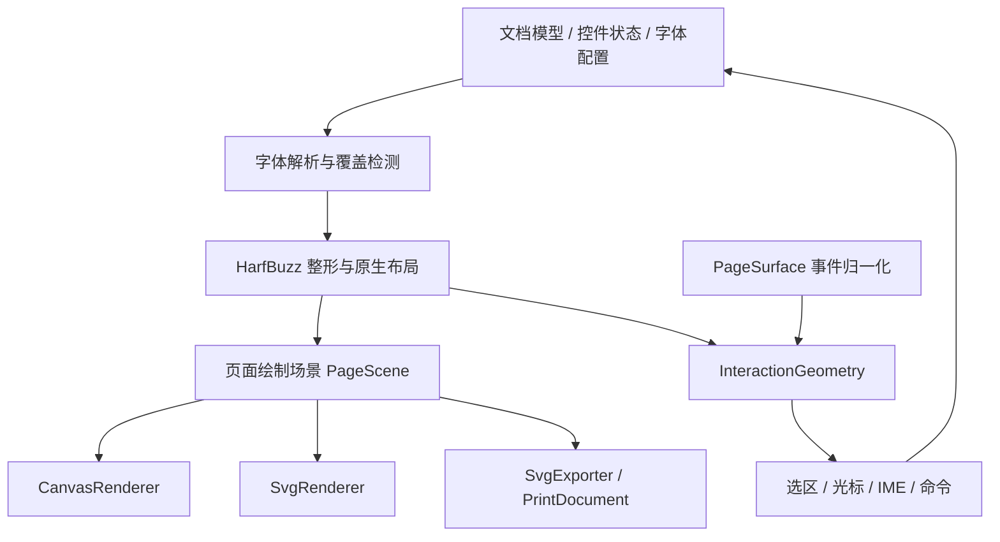

# HarfBuzz 原生管线完整接入 SVG：评估与实施方案

> **实施状态：暂缓。** `@herberthe/canvas-editor@0.1.0` 默认且仅支持 Canvas 页面绘制；
> 本文所有架构、renderer 选项和 SVG-01～12 任务均为未来方案，当前未提供 SVG 后端或 SVG 文档导出。

## 1. 范围和结论

评估基于 `cec432b8`，当时 T23/T24 暂缓。2026-10-22 已恢复并完成
[T23/T24 验收](./native-release-acceptance.md)，对应延期状态由验收记录维护。
本 SVG 方案仍暂缓，只保留评估，不实现 SVG 后端。

这里的“完整 SVG”按以下目标评估：SVG 可以承载完整的可编辑文档页面，
覆盖正文、辅助文字、控件、表格、对象、选区、打印和独立 SVG 导出。
不是只把 Canvas 截图包进 SVG，也不把浏览器 SVG 文字排版重新引入文字管线。

**结论：技术上可行，现有 HarfBuzz 字形和原生几何适合复用；完整接入是一次绘制层与页面宿主改造。**

- 字体加载、Bunny 自动下载、覆盖报告、整形、换行和分页保持同一套逻辑。
- 编辑器文字由 HarfBuzz 字形轮廓生成 `<path>`，按现有位置绘制。
- Canvas 与 SVG 在迁移期间共享排版和绘制场景，便于逐功能对照。
- SVG 页面的文档文字不使用 `<text>/<tspan>`，也不依赖 DOM 文字测量。
- bitmap 图片仍是图片；iframe/video 仍需在线 HTML 宿主或静态快照。
  “文字和几何矢量化”不意味着能够把任意媒体无损转换成纯矢量对象。

不能把“替换 `GlyphRenderer`”作为完整交付：这只能解决字形，不能覆盖交互、
表格边框、装饰、水印、Block、放大镜和导出等现有能力。

## 2. 现有代码的真实可复用程度

| 模块                                       | 已具备的基础                                       | SVG 接入仍需完成的工作                                 |
| ------------------------------------------ | -------------------------------------------------- | ------------------------------------------------------ |
| `core/text-engine/HarfBuzzRuntime.ts`      | 共享异步 WASM 运行时                               | 直接复用，SVG 同样等待 ready                           |
| `core/text-engine/font/FontManager.ts`     | 实际 face、字形编号、尺寸、字体版本                | 直接复用，不能根据 CSS family 再找浏览器字体           |
| `core/text-engine/font/GlyphOutline.ts`    | Y 向下的轮廓命令、`pathData`、包围盒、有界缓存     | 建立 SVG defs/use 缓存与生命周期                       |
| `interface/Layout.ts`                      | 字形、cluster、caret、行、对象、表格片段和页面协议 | 补齐实际页面绘制快照，不能把接口声明等同于完整场景实现 |
| `core/layout/InteractionGeometry.ts`       | 原生 caret、命中与选区矩形                         | 复用几何；统一浏览器事件到页面坐标的转换               |
| `core/text-engine/render/GlyphRenderer.ts` | 字形轮廓绘制与缺字方框                             | 将 Canvas 路径调用拆成共享绘制命令和后端适配           |
| `core/text-engine-host/drawPlainText.ts`   | 辅助文字也使用 HarfBuzz                            | 分离测量/整形与具体绘制目标                            |
| `core/draw/Draw.ts`                        | 原生布局与页面绘制编排                             | 分离 Canvas 页面、绘制、事件、导出职责                 |
| `core/draw/particle/*`                     | 对象与装饰的现有行为                               | 输出后端无关的几何和绘制样式                           |

当前没有完整 SVG 页面后端或 `getSVG` 导出接口。已有 SVG 主要是图标、
公式资源和 Demo 的批注连接线。`_createPage()` 仍创建 Canvas，`getPageList()`
仍返回 `HTMLCanvasElement[]`，`getDataURL()` 仍直接调用 Canvas `toDataURL()`。

静态扫描发现 50 个 TypeScript 文件引用 `CanvasRenderingContext2D` 或
`HTMLCanvasElement`。这是耦合面的下界，不是最终文件修改数量或工作量估算。

还有一个重要缺口：虽然存在 `DocumentLayout` 类型和 `nativeNodes` 收集参数，
当前主绘制仍经由 `LayoutRow`、源元素样式、宿主状态及各 Particle 组合完成。
背景、装饰、打印规则和实时颜色并非完整封装在一个可独立消费的页面树中。
SVG 后端不能仅遍历 `Layout.ts` 中的节点就保证视觉等价。

## 3. 推荐架构



### 3.1 排版层保持唯一

两种绘制后端消费相同的整形、字体和分页结果。禁止 SVG 分支自行断行、
改变 RTL 顺序、根据元素文字重新生成字形，或通过 `getBBox()`、
`getComputedTextLength()` 等 DOM 文字几何反推布局。

SVG `<text>` 的文字仍进入浏览器 CSS 文字排版过程；设置 x/y/dx/dy
并不能等价于直接消费指定 face 的 HarfBuzz glyph ID。因此，本文推荐路径轮廓方案。
参见 [W3C SVG 文字布局规范](https://www.w3.org/TR/SVG/latest/text.html)。

### 3.2 新增绘制场景，而不是复制 Draw

建议增加 `core/render/`，名称为设计建议，尚未实现：

```text
core/render/
  PageScene.ts
  SceneCollector.ts
  PageSurface.ts
  AssetRegistry.ts
  canvas/CanvasRenderer.ts
  svg/SvgRenderer.ts
  svg/SvgGlyphRegistry.ts
  svg/SvgSerializer.ts
  export/ExportSnapshot.ts
```

`PageScene` 至少描述：

- 页面尺寸、方向、绘制模式和版本；
- 有稳定标识的图层、分组、变换与裁剪；
- path、rect、line、circle/ellipse、glyphRun、image 和 pattern；
- 明确的 fill/stroke、线宽、虚线、连接点、端点、填充规则和逐项透明度；
- 图片源裁剪矩形、目标矩形、资源引用和资源状态；
- 从绘制对象回到 scope/source 的映射；
- 编辑态可见性、打印态可见性，以及独立的交互覆盖层。

场景收集器从原生布局、源样式和宿主模式生成最终绘制属性。SVG 和 Canvas
都不再各自解释表格、控件、装饰规则。迁移时先让 Canvas 适配已迁移模块，
保持可对照的参照；未迁移模块不能在 SVG 模式下静默消失。

不建议直接把完整 `CanvasRenderingContext2D` 模拟成 SVG context。
当前存在状态栈、路径、图片裁剪、异步加载和 pattern；模拟器容易变成第二套有状态绘制引擎。
应抽象实际需要的绘制语义，避免导出 Canvas 像素读取接口作为后端公共能力。

### 3.3 页面宿主独立

`PageSurface` 管理页面元素、视口、页面编号、坐标转换、尺寸变化、懒挂载与销毁。
Canvas 页面和 SVG 页面各实现一个 surface；上层事件和工具只依赖统一接口。

建议新增 `getPageElements()` 或等价内部能力，迁移 `getPage/getPageList/getCtx`
相关消费者。不能把 SVG 强制断言成 `HTMLCanvasElement`。

若提供 `renderer: 'canvas' | 'svg'`，它仅选择绘制后端，文字引擎始终为 HarfBuzz。
不要复活已移除的 `textEngine/renderMode`。第一阶段建议仅构造时选择；
运行时切换需要额外处理 DOM、监听器、资源引用和 Block 宿主，不纳入首期隐含承诺。

## 4. 字形怎样准确绘制为 SVG

### 4.1 可直接复用的路径

`GlyphOutlineCache` 已返回 `pathData`，其轮廓已按实际字号转换为基线相对 CSS 坐标，
并且 Y 轴已经向下。SVG 不能再施加一次字体坐标翻转，否则字形会倒置。

与当前 `drawNativeLine` 等价的单字形页面位置为：

```text
pageX = placedX + scale * (line.rect.x + glyph.x + glyph.offsetX)
pageY = placedY + scale * (line.rect.y + line.baseline + glyph.y + glyph.offsetY)
```

此公式使用当前宿主的 placed 坐标和 scale 约定。不能把坐标归一化方案与当前公式混用。
将来场景统一到未缩放页面单位时，应在收集边界完成一次明确转换，再由页面宿主统一缩放。

首个验证版本可以逐字形生成 `<path d="..." transform="...">`。
正式编辑后端建议页面内 `<defs><path id="..."/></defs>` 配合 `<use href="#...">`，
复用同一字形轮廓；颜色放在实例上。参见 [MDN use](https://developer.mozilla.org/en-US/docs/Web/SVG/Reference/Element/use)。

缓存键至少包含实际 faceId、fontRevision、glyphId、字号/轮廓坐标约定。
当前轮廓已按字号缩放，不能仅按 glyphId 复用不同字号的路径。
若后续改为字体设计单位缓存，必须另行明确 unitsPerEm 和 Y 轴变换，不应在首次迁移同时更换。

### 4.2 版本与资源生命周期

- 字体下载完成后，复用现有 fontRevision 触发重新整形和布局，再更新 SVG。
- SVG defs 的 ID 应包含实例/页面前缀，避免多编辑器、复制页和批量导出时冲突。
- defs 节点应有引用计数或页面级生命周期；原生轮廓缓存有界，不代表 SVG DOM 自然有界。
- 静态导出每页应带齐本页用到的 defs，不能依赖另一个页面或已卸载页面。
- DOM 属性须通过安全的构造/序列化途径写入；资源 SVG 合并时要重写内部 ID 引用。

### 4.3 缺字与彩色字体

缺字继续使用 `MissingGlyphBox` 的矩形、逻辑文本和合法 caret；
SVG 负责画占位框，Bunny 下载与诊断不需要第二套实现。

当前轮廓层对不支持的彩色字形会返回 unsupported；改成 SVG 后不会自动支持
COLR/CPAL、OpenType SVG 或 bitmap emoji。现有不支持提示与占位策略必须保留。
若未来扩展彩色字体，应作为独立字体资源/绘制能力立项，不能借 `<text>` 暗中交回浏览器。

## 5. 功能覆盖与影响范围

| 功能                         | SVG 绘制方式                        | 主要改造位置与验收点                                         |
| ---------------------------- | ----------------------------------- | ------------------------------------------------------------ |
| 正文、RTL、复杂脚本、上下标  | glyph path/use + 既有 HB 位移       | `GlyphRenderer`、`SceneCollector`；字形和 cluster 位置一致   |
| 页眉页脚、页码行号、占位文字 | 同一 glyphRun 指令                  | frame、`drawPlainText`；混合纸张方向与每页变量正确           |
| 列表标记、标尺数字、图片题注 | HB 字形 + shape                     | ListParticle、Ruler、ImageParticle；省略号继续按真实整形测量 |
| 高亮、下划线、删除线、留痕   | rect/path，按原生内容高度定位       | richtext、TraceParticle；不把段后间距画进装饰                |
| 边框、区域背景、页边距       | rect/path                           | frame、Area、control/richtext；打印/设计态规则一致           |
| 复选框、单选框、控件空间     | rect/circle/path，文字仍为 glyphRun | Checkbox/Radio/Control；标签点击和 minWidth 不重新布局       |
| 合并/嵌套/跨页表格           | cell group、边框路径、clipPath      | TableParticle、TableTool；重复表头和续排窗口无泄漏           |
| 图片、背景、签章、浮图       | image + 明确的源裁剪与变换          | ImageParticle、Background、Badge；异步资源稳定后导出         |
| 公式                         | 复用内部生成的 SVG path             | LaTexParticle/LaTexUtils；保留矢量，不经 Canvas 截图         |
| 水印                         | glyph/image + pattern/transform     | Watermark；重复、角度、透明度与上下层一致                    |
| 涂鸦                         | path/polyline                       | Graffiti；坐标、线宽和指针归一化                             |
| 搜索、分组、选区、拼写提示   | 独立覆盖层 rect/path                | Search/Group/Range/Spellcheck；交互状态变化不重排全文        |
| 放大镜                       | 裁剪区域重新渲染同一场景            | Magnifier；不能继续从 SVG 调用 Canvas drawImage              |
| 图像预览                     | 专用 HTML 或 SVG 预览宿主           | Previewer；允许 UI 实现独立于文档页面                        |
| iframe/video                 | 对齐原生 block 几何的 HTML 覆盖层   | BlockParticle/BaseBlock；导出需要显式快照策略                |
| 打印与图片导出               | 同一场景的独立输出任务              | Draw.getDataURL、CommandAdapt.print、utils/print             |

### 5.1 表格和裁剪是高风险项

沿用 `TableFragment` 和 `TableCellLayout.clip`，不重新根据 SVG 子节点计算表格高度。
裁剪应显式采用 `clipPathUnits="userSpaceOnUse"`，并区分 cell、fragment、page
各自的坐标空间。默认对象包围盒单位不适合直接放入原生页面坐标。
参见 [MDN clipPathUnits](https://developer.mozilla.org/en-US/docs/Web/SVG/Reference/Attribute/clipPathUnits)。

同一 source 节点可以在多个页面、重复表头、横竖版页眉里出现。
DOM key 至少要区分 page、scope、node、fragment window、layer，不能只使用 nodeId。
否则 DOM 复用会把一个片段搬走，造成缺行或重复表头消失。

### 5.2 图片裁剪必须对应九参数 drawImage

当前 `ImageParticle._drawImageWithCrop` 使用源像素矩形与目标矩形。
SVG 应把完整图片按源裁剪比例映射到目标坐标，再对目标矩形裁剪。
仅设置一个 `<image width height>` 或任意使用 `preserveAspectRatio="slice"`
并不等价于现有的任意源裁剪。

### 5.3 图层和透明度不能顺手简化

依据当前 `_drawPage/drawRow` 固定绘制顺序迁移：背景、底层水印、区域/高亮、
底层浮图、正文与对象、页眉页脚、上层浮图、搜索/选区/提示、边框签章、涂鸦和上层水印等。
实际实现应逐处保留当前顺序，而不是仅以此简表重新排序。

Canvas `globalAlpha` 通常逐次作用于绘制；SVG 在父 `<g opacity>` 上透明合成
可能改变重叠区域效果。场景应区分逐项透明度与整体分组合成。
类似地，现有 0.5 像素平移、四舍五入、DPR 相关线宽需从布局几何里分离成绘制策略，
不应直接把 Canvas 像素对齐技巧当作 SVG 几何规则。

## 6. 完整编辑交互怎样保留

### 6.1 统一事件入口

当前 mousedown、mousemove、mouseup、drag、双击和涂鸦读取 `evt.offsetX/offsetY`。
Canvas 的目标通常是页面本身；SVG 的目标可能是 path、use、group、clip 内的对象。
继续按目标元素的 offset 解释页面坐标会造成命中漂移。

建议统一生成 `PagePointerEvent`，包含 pageNo、页面坐标、client 坐标、修饰键与原事件。
对于 SVG，使用**页面根或约定内容根**的 `getScreenCTM().inverse()`
转换 `clientX/clientY`；不能使用当前 glyph 的变换矩阵。
需处理 SVG 未挂载、矩阵为空或不可逆的情况。
参见 [MDN getScreenCTM](https://developer.mozilla.org/en-US/docs/Web/API/SVGGraphicsElement/getScreenCTM)。

若转换结果已为未缩放页面单位，进入现有 Position 之前要适配其缩放坐标约定，
不能再把 zoom 除一次。滚动、页面居中、不同页宽、嵌套宿主和 CSS transform 均需验证。

页面应有覆盖整页、包含空白区的命中入口。可采用背景事件矩形和禁止文字装饰层接管命中的设计。
SVG 命中可通过 pointer-events 控制，但编辑器仍以原生逻辑几何决定 caret 和控件目标。
参见 [MDN pointer-events](https://developer.mozilla.org/en-US/docs/Web/SVG/Reference/Attribute/pointer-events)。

### 6.2 保留原生编辑几何与输入代理

- caret、连字内部停靠点、RTL affinity、Shift 锚点、表格选区全部复用现有几何。
- 继续使用 HTML textarea 输入代理处理键盘、IME、粘贴和移动端 beforeinput。
- DOM 光标、日期/下拉/计算器弹层和对象缩放手柄可以继续保留，统一由 PageSurface 定位。
- 迁移 `ZoneTip` 的 `instanceof HTMLCanvasElement` 判断和各处 page target 强制转换。
- GlobalEvent 的“点击编辑器内部”识别必须包括 SVG 后代、覆盖层和原有输入代理。
- 区分页面输入、原生 HTML Block 输入与 UI 输入；不能用透明事件矩形盖住 iframe/video。

SVG path 不提供文字语义。编辑器内复制、搜索、选择继续从文档模型取逻辑文字；
现有 Accessibility 可复用状态播报，但它不等于完整可访问文档树。
如需要全文屏幕阅读，应独立提供按逻辑顺序的语义层，不能让视觉 path 代替语义。
纯 path SVG 在外部查看器中的原生文字选择和 Ctrl+F 不能承诺保留，
可提供独立逻辑文本/结构化元数据；这不等于可搜索 PDF，也不能靠隐藏重复文字保证阅读顺序。

## 7. SVG 导出与打印应分开设计

### 7.1 独立 SVG

建议提供新的 `getSVG()` 或等价接口，返回逐页 SVG 文本及导出诊断，
不改变既有 `getImage()` 的 PNG 返回语义。页面拥有独立 viewBox、宽高和 defs。
混合横竖版按页保存；多页打包或拼成长图作为额外输出策略。

独立 SVG 的导出流程：

1. 等待 editor.ready，固定文档、字体、模式和资源版本。
2. 明确使用当前字体结果，或在有限超时内等待当前自动下载任务；ready 本身不等待后台下载。
3. 若等待期间字体/内容变更，重取稳定快照；若超时或缺字仍存在，保留方框并返回报告。
4. 生成 print/presentation 场景，等待所需图片、公式和显式 Block 快照。
5. 嵌入本页资源、序列化并检查未解析引用；异常时清理资源。

不要通过短暂切换在线编辑器模式、重新渲染截图来实现 SVG 导出。
这会把异步字体、图片、选区和用户正在输入的状态混在一起。
新输出任务应消费不可变快照，并在 finally 中清理临时宿主、URL 与资源订阅。

字体已转换为 path 后，导出的文字视觉无需下游加载字体；
但生成字形时依然需要真实字体，不能承诺“缺字体也能正确导出”。

外部图片、背景和嵌套 SVG 资源需要明确的内嵌策略。SVG 作为 image 使用时，
外部资源和脚本等会受到限制，不能把编辑页里能显示当作独立文件也能显示。
参见 [MDN SVG as an image](https://developer.mozilla.org/en-US/docs/Web/SVG/Guides/SVG_as_an_image)。
自包含导出默认不留下运行时 blob URL；无法获取的跨域资源、尚未完成的图片或 Block
应返回明确诊断/失败，而不是静默丢失。

### 7.2 PNG 和打印

- PNG 可从稳定 SVG/共享场景显式栅格化；这是输出适配，不是文字重新走 Canvas 排版。
- 若要求连辅助功能也完全不使用 Canvas，应另定交付目标：浏览器内 PNG 编码、
  视频帧获取、旧预览等也要替换或由宿主提供能力。这不同于页面 SVG 化。
- 浏览器打印可在独立 HTML 打印宿主中放逐页 inline SVG，维持分页和页面方向。
  原有 `utils/print.ts` 的 PNG 与 iframe 叠加流程不能直接视为已支持 SVG。
- 混合纸张打印、浏览器 PDF 输出、裁剪与嵌图必须逐浏览器实测；SVG 不自动等于可搜索/可访问 PDF。

### 7.3 iframe/video 与外部 SVG 的边界

在线编辑：继续用 HTML 覆盖层展示 iframe/video，位置和裁剪来自同一 Block 几何。
独立 SVG：使用宿主提供的显式快照或视频 poster/帧；没有可用快照时报告不支持或资源缺失。
不把任意网页和视频宣传为可自动转换的矢量内容。

`foreignObject` 可以承载其他命名空间内容，但不是跨查看器稳定导出的默认解法，
其中 HTML 文字仍由 HTML/CSS 排版。参见 [MDN foreignObject](https://developer.mozilla.org/en-US/docs/Web/SVG/Reference/Element/foreignObject)。
若未来提供浏览器专用富内容导出，应以独立能力明确标注支持范围。

公式当前由内部 LaTex 工具生成 path，可保留为矢量对象；它属于公式对象自身的几何，
不等同于正文回退到浏览器文字引擎。用户图片里的文字、跨域 iframe 内文字同样属于不透明资源内容；
若要求这些内容内部也全由本编辑器 HarfBuzz 排版，就需要相应文档转换器，不能由 SVG 后端自动满足。

## 8. 性能与增量更新评估

不承诺 SVG 比 Canvas 更快。SVG 可复用路径并保持放大清晰，也会增加 DOM、样式匹配和图层合成成本。
一字形一 DOM 节点的长文档必须实测；不能根据纯文本小样本推导复杂表格的性能。

建议的设计约束：

- 按页面虚拟挂载，卸载页面时回收 defs/资源引用，保持逻辑几何可用于导航。
- 以行或块为 DOM 更新单元，复用稳定 key；避免每次输入整页 innerHTML 重建。
- 保留 fontRevision 与原生段落缓存，但新增绘制样式、控件状态、资源状态和交互状态的失效维度。
- `isCompute:false` 下的勾选、选区、搜索、颜色变化也必须更新 SVG；不能只看布局版本。
- 颜色或选区变化只更新对应属性/覆盖层；字体到达则按既有规则重排。
- 区分“段落整形复用”“分页位置重算”“SVG DOM 局部更新”，三者不是同一层增量优化。
- defs/use 减少轮廓重复，但不会消除每个字形实例的 DOM 成本；同色路径合并可作为后续候选，
  须保留 source/cluster 命中和样式覆盖能力。

SVG 自身实施过程中仍需最小规模性能门槛，防止 DOM 泄漏和交互卡死；
这不等于恢复原 T23 的完整基线性能与发行验收任务。

## 9. 可逐步执行的子任务

以下为新 SVG 工作线，编号与 T23/T24 独立。当前均为待实施。

| 编号  | 工作与交付                                                     | 验收条件                                                                  |
| ----- | -------------------------------------------------------------- | ------------------------------------------------------------------------- |
| SVG01 | 定义页面宿主、坐标、场景、资源和输出契约；建立现有绘制顺序清单 | 固定一个原生布局快照可同时喂给两后端，无布局反向依赖                      |
| SVG02 | 字形路径原型与 defs/use 生命周期                               | 本地五类字体、RTL、组合符、连字、缺字方框位置与现有后端一致；无 text 元素 |
| SVG03 | 共享绘制指令和 Canvas 适配，迁移基本图形/装饰                  | 已迁移模块仅保留一份样式和几何规则，Canvas 对照不退化                     |
| SVG04 | 正文、辅助文字、控件和完整页面图层                             | 所有可见文字均追踪到 HB face/glyph；编辑/打印可见性正确                   |
| SVG05 | 表格、分栏、混合方向和裁剪窗口                                 | 合并、嵌套、重复表头、拆行、maxPageNo 与原生几何一致                      |
| SVG06 | 图片、公式、背景、签章、水印及涂鸦                             | 任意源裁剪、重复 pattern、异步加载和公式矢量化完整                        |
| SVG07 | 统一页面事件与工具定位                                         | 空白点击、SVG 子节点点击、拖选、跨页和缩放坐标无漂移                      |
| SVG08 | 编辑覆盖层、输入代理、Block 宿主和放大镜                       | IME、beforeinput、控件、缩放手柄、Block 和放大镜在 SVG 页面可用           |
| SVG09 | 稳定导出快照和自包含逐页 SVG                                   | 不依赖在线 DOM/外部 defs/blob URL；下载中、失败和补字闭环有明确结果       |
| SVG10 | PNG/打印适配与资源诊断                                         | 保留 getImage 语义，独立打印宿主支持各页方向；失败不污染编辑器状态        |
| SVG11 | 页面虚拟化、局部 DOM 更新与缓存释放                            | 编辑态小更新不重建全部页，卸载/重载/字体变化后无陈旧 defs 或持续增长      |
| SVG12 | 双后端差分、浏览器矩阵、API 文档与阶段性切换评审               | 功能等价证据完整，明确纯 path 的文本语义和媒体边界，不静默关闭功能        |

建议推进顺序：SVG01 → SVG02 → SVG03/04 → SVG05/06 → SVG07/08 → SVG09/10 → SVG11/12。
这是依赖顺序建议，并非授权启动并行实现。

最早可交付的是字形原型或静态页面导出；它们只能标记对应阶段完成，不能标记“完整 SVG 编辑器完成”。
是否默认启用 SVG，以及是否最终删除 Canvas 页面后端，留待功能等价证据和用户决定，
不要在评估阶段连带改变当前默认后端。

## 10. 完整验收矩阵

| 维度           | 必测内容                                                                           |
| -------------- | ---------------------------------------------------------------------------------- |
| 同源几何差分   | 同一布局快照的 face/glyph、位置、分页、cluster、caret、选区矩形精确对应            |
| 图像差分       | 两后端统一视口、scale、DPR、资源和状态；允许栅格抗锯齿差异，不允许几何漂移         |
| 文字与辅助文字 | 中文/Latin/RTL/Devanagari/Thai、组合符、连字、emoji 占位；页眉脚、水印、题注、标尺 |
| 表格与对象     | 合并/嵌套、重复表头、续页裁剪、分栏、浮图、公式、背景、iframe/video 快照           |
| 输入与交互     | 鼠标、双击/三击、Shift、拖选、跨页、IME、移动端删除、控件点击、撤销重做            |
| 坐标组合       | 0.5/1/2 倍缩放、多 DPR、滚动容器、页面居中、混合页宽、宿主 CSS transform           |
| 模式           | edit/form/readonly/design/print/trace/graffiti，辅助层和 Block 可见性              |
| 字体闭环       | 默认开启、false 零请求、失败、重试、下载中导出、注册补字恢复、多实例与销毁         |
| 独立性         | 将导出 SVG 放入新页面、作为 image、离线加载、逐页单独加载；无缺失 defs/资源        |
| 资源释放       | 反复编辑、缩放、换文档、卸载页面、注册字体、销毁后，DOM/defs/URL/缓存有界          |
| 浏览器         | Chromium/Firefox/WebKit；打印与独立 SVG 查看分别记录，不由一个浏览器通过推断全部   |

建议把现有 Cypress 从 `cy.get('canvas')` 迁移为通用页面选择器及 PageSurface 测试工厂，
保留后端专用 Canvas 像素测试，并增加 SVG DOM、序列化和栅格化后的视觉测试。
测试必须识别业务页面与标尺、预览等辅助 Canvas，避免“页面无 Canvas”断言误判。

守卫要覆盖 SVG `<text>/<tspan>`、SVG DOM 文字测量、Canvas 文字 API 和旧引擎引用。
其范围是文档绘制管线；HTML 工具栏、诊断和无障碍语义层不因此禁止正常显示 UI 文字。

## 11. 本次评估的确定性和后续决策

已由代码确认：轮廓路径可复用、排版/交互几何可复用、页面仍硬绑定 Canvas、
图片/Block/放大镜/打印存在专用耦合，并且当前没有可独立输出完整页面的 SVG 后端。

尚未实施或测量：SVG 原型、全部图形等价、DOM 更新成本、长文档阈值、混合纸张打印兼容性、
独立查看器资源兼容性。本文不给出未经原型和基准验证的覆盖百分比或性能提升数字。

推荐采用“同一 HarfBuzz 排版 + 共享绘制场景 + SVG 页面后端”的方向，
先建立字形与页面场景的对照证据，再扩展到完整编辑和导出。
