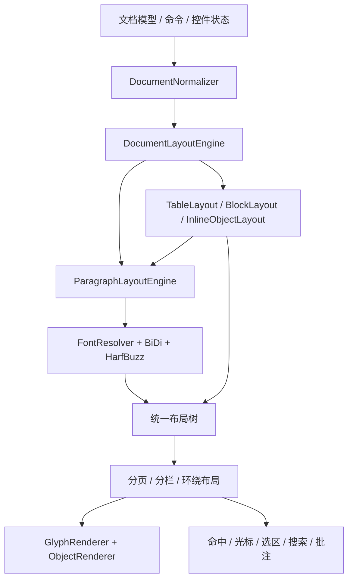

# 彻底移除 legacy、统一 HarfBuzz 排版的实施方案

> 历史方案/基线记录，保留当时结论供审计。旧引擎、模式选择与浏览器文字回退
> 已由 T20 删除；当前 API、字体能力与示例以[迁移指南](./font-and-esm-migration.md)为准。

## 1. 结论与范围

评估基线：`refactor/canvas-render-engine`，`fd11752e`。
本文件是实施方案，不代表下面的迁移已经完成。

本方案已按用户决定收敛为：`autoDownloadFonts` 默认开启，缺字时从 Bunny Fonts 自动补基本字体；
关闭开关或下载失败时，页面与控制台提示手动补字体包；
旧循环中的有效布局职责先拆出再删除；发行包只支持 ESM，完全取消 UMD。
可逐步执行的子任务见 [执行任务清单](./legacy-removal-tasks.md)，以该清单中的依赖和验收为准。

这是一次排版架构与公共接口迁移，不能用删除配置开关代替。
当前 HarfBuzz 模式仍借用旧引擎布局表框、块和浮动元素，还会使用浏览器整形、
测宽和文字重绘。彻底移除需要同时替换这些依赖。

本方案采用严格口径：

1. 编辑器管理的所有受字体覆盖的正常文字，包括中英文、复杂文字、控件文字、表内文字、页眉页脚、
   列表编号、页码、水印、题注和占位提示，都通过 HarfBuzz 生成字形与度量。
2. 字体失败、引擎未就绪、特殊元素或复杂布局，均不进入旧引擎或浏览器文字整形。
3. 文字绘制消费同一份 HarfBuzz 字形结果，不再让 `fillText` 对正文重新整形。
4. 表格、图片、公式、复选框、分隔线和嵌入块是非文本布局对象，由专用布局器处理；
   它们的存在不能触发旧文本引擎。公式自身的数学渲染器不改造成 HarfBuzz。
5. 保留 Canvas 图形绘制（SVG 页面实现暂缓；SVG 图像等资源仍可使用）、正常 DOM 工具栏和输入法代理；它们不是 legacy 引擎。

最终形态为一条排版路径、一个布局结果和一套命中/光标几何。
纯文本增量与复杂文档全量计算可以并存，但两者必须使用相同的 HarfBuzz 引擎。

## 2. 当前真实依赖

| 层级           | 当前代码                                                                                                         | 移除影响                                                                             |
| -------------- | ---------------------------------------------------------------------------------------------------------------- | ------------------------------------------------------------------------------------ |
| 公共模式       | `dataset/enum/TextDirection.ts`、`interface/Editor.ts`、`interface/TextEngine.ts`、`index.ts`、`utils/option.ts` | 默认仍是 `LEGACY`；需要移除 `TextEngineMode`、`textEngine` 和重复的模式选项          |
| 初始化         | `index.ts`、`core/draw/Draw.ts`、`text-engine-host/LayoutHostAdapter.ts`                                         | 同步构造先排版，异步初始化后重排；初始化失败还能使用浏览器 shaper                    |
| 主入口         | `Draw.computeRowList`                                                                                            | HarfBuzz 未就绪、没有返回行、`forceLegacy` 时进入旧逐元素布局循环                    |
| 对象插行       | `Draw._computeRowListByTextEngine`、`_isEngineHostBlockedElement`                                                | TABLE/BLOCK/AREA 和浮动图片仍通过 `forceLegacy: true` 插行                           |
| 表格几何       | `Draw.computeRowList` 的 TABLE 分支                                                                              | 列宽压缩、单元格递归布局、rowspan 高度传递等仍放在旧循环内，不能直接删除             |
| 旧增量         | `core/draw/IncrementalRowComputer.ts`                                                                            | 同时负责旧行快照和通用脏区间追踪；当前 HarfBuzz 仍依赖后者                           |
| 旧类型         | `interface/Draw.ts`、`interface/Row.ts`                                                                          | `resume`、`forceLegacy`、`IRowComputeState` 与双路径行结构需要重构                   |
| 行投影         | `text-engine-host/mapToLegacyRow.ts`                                                                             | 当前新引擎结果仍投影到旧 `IRow`，并写入元素的 metrics/visualLeft/sourceIndex 等字段  |
| 旧文字粒子     | `draw/particle/TextParticle.ts`、Draw 中的实例/访问器                                                            | 逐元素测宽、缓存、词与标点测量、拼接文字、逐字兼容绘制                               |
| 特殊文字绘制   | Hyperlink/Label/Date/Superscript/Subscript 分支                                                                  | 按 `engineLine` 是否存在决定走新绘制还是旧 Particle；需保留背景/交互，移除旧文字绘制 |
| 隐性浏览器整形 | `text-engine/shape/BrowserTextShaper.ts`、`HarfBuzzTextShaper.ts`                                                | 拉丁/CJK、缺字体、无轮廓等会回退；HB advance 还会按浏览器测宽重新缩放                |
| 隐性二次整形   | `text-engine/render/GlyphRenderer.ts`                                                                            | 有段落原文时优先使用视觉分段 `fillText`，复杂脚本最终仍由浏览器重整形                |
| 额外文字测绘   | frame 的 LineNumber/PageNumber/Watermark；particle 的 List/Image/PageBreak/Trace；ruler/Ruler                    | 保留了直接测宽/绘字路径，不能只清理正文                                              |
| 表格自动列宽   | `particle/table/TableOperate._measureTdContentWidth`                                                             | 逐元素相加，不能作为整形文字的真实内在宽度                                           |
| 命中与坐标     | `core/position/Position.ts`、`core/cursor/Cursor.ts`、`text-engine-host/HitTestAdapter.ts`                       | 累加 x 与 visualLeft 并存；光标需要区分文字基线与图片顶对齐偏移                      |
| 测量 API       | `CommandAdapt.computeElementListHeight`、Header/Footer/Placeholder、TablePaging                                  | 依赖同步行计算及布局 scope；需要统一 readiness 和测量上下文                          |
| 配置/文档/测试 | mock、选项文档、RTL 设计文档、测试工厂与 Cypress                                                                 | 默认行为、字体资源、ready 等待和旧固定度量断言都会受影响                             |

当前 `public/fonts` 中只有 Arabic、Devanagari、Thai 三份字体。
没有足够证据证明已覆盖默认中文字体、Latin/CJK 全字符、所有字重和 emoji。
不再要求发行包预先覆盖全部文字。删除浏览器回退前，必须实现准确的缺字诊断、
默认自动下载/关闭后的手动提示与可编辑占位；Bunny 下载本期必做，见 DEFER-026。

## 3. 目标架构与职责

下列新模块名是建议的实施落点，不是当前已有文件。

- `DocumentNormalizer` 处理格式化、控件语义和段落结构，不计算字宽。
- `FontResolver` 负责真实字体文件、字符覆盖、字重/斜体匹配和字体版本。
- `ParagraphLayoutEngine` 负责 BiDi、整形、断行、行盒和对齐。
- 非文本布局器提供宽高、基线、内边距、可拆分边界和子布局，不调用旧循环。
- 文档流布局负责容器宽度、分页、混合纸张方向、分栏和环绕约束。
- 统一结果保存文字行、对象盒、表格片段、cluster、caret stops 和文档索引映射。
- 绘制和命中只消费该结果，禁止再次测量文档文字或自建第二套对齐公式。

不要让 HarfBuzz 承担整个文档模型：BiDi、分页、表格、控件和数学公式仍有独立职责。
彻底移除的是旧排版实现及其回退，不是删除这些必要功能。

## 4. 必须先解决的基础能力

### 4.1 字体与单一整形源

扩展 `FontManager`，形成统一字体解析与资源生命周期服务：

- 提供最小基础字体 manifest，明确实际覆盖范围，不要求预置完整 CJK 或所有文字字体。
- 将字体家族、weight、style 和需要支持的字体格式映射到可被解析的真实字体数据。
- 按 grapheme/cluster 与整形上下文选择字体，不能逐 UTF-16 码元选字体，
  也不能为一个缺字打断阿语连写或 emoji ZWJ 序列。
- 对 HB 输出中的缺字结果重新解析备用字体，必要时重整相关上下文。
- 对所有备用字体继续调用 HarfBuzz；禁止退回系统字体 `measureText`。
- 所有已加载字体均无法覆盖时，聚合缺字/缺序列诊断。`autoDownloadFonts` 默认 true，
  根据实际文种与覆盖范围从 Bunny Fonts 下载基本字体；false 时不自动请求，
  在页面和控制台提示需手动补充的文字类别、有限样例、Unicode 码点和缺失数量。
- 缺字作为可恢复问题，保留原文、索引和编辑能力，使用明确的缺字占位；不能静默画空白。
  其他已注册字体能覆盖时应先正确选用备用字体，不能仅因首选字体缺字就报缺失。
- 字体下载/解析失败与缺字符分开报告；失败、无适用字体、下载后仍缺字均转手动提示。
- Bunny CSS 元数据须转成真实字体二进制供 HB/字形后端注册；纳入 WOFF2 解码、
  unicode-range 多片段、请求去重、缓存、开关切换和生命周期取消。
  不能只插入 CSS 后宣称 HarfBuzz 已有字体；具体执行见 T06A/T06B。
- 字体版本进入整形缓存和布局缓存 key；字体变化使所有相关 scope 失效。
- 明确字体字节、HB face/font、轮廓/路径缓存的释放规则，覆盖 destroy 和重载。

删除 `BrowserTextShaper` 后，行内对象的占位 advance 由 `InlineObjectLayout`
直接提供，不能为了占位对象继续保留浏览器 shaper。

`HarfBuzzTextShaper` 必须同时整形 Latin/CJK/Arabic 等所有文字：
删除简单脚本绕行、缺字体绕行、无轮廓绕行和 `alignAdvancesToBrowser`。
字距、显式 `element.width`、连字和字重的最终度量规则必须统一定义。

### 4.2 字形绘制与布局一致

当前优先分段 `fillText` 的策略必须替换，否则仍不是完整的单一整形源。

- 普通文字按 `fontFaceId + glyphId + position` 绘制字体轮廓或栅格化字形。
- `glyphId` 所属字体和字号必须在结果中明确，不能只保留原字符串。
- 使用 HB advance/offset 和字体 ascender/descender/lineGap，不再回算浏览器宽度。
- 多色文字不拆断连写；跨颜色的连字需要明确按 cluster 的着色/裁剪规则。
- 上下标、letterSpacing、kashida、下划线、删除线和留痕共用字形与基线几何。
- 空格、零宽符、BiDi 隔离符保留逻辑映射，但不要求存在可见轮廓。
- 路径不可用时切换到基于同一字体与 glyphId 的字形渲染后端，不能恢复 `fillText`。
- 彩色 emoji 需有明确的颜色字形/图片对象渲染策略和相同的 HB 布局度量；
  未完成前不能宣称现有 emoji 显示能力已无损迁移。
- 字形 atlas 可以后续优化；删除 legacy 不以建设 atlas 为前提。

还要验证真实换行边界的整形结果。不能依赖当前浏览器重绘去修复行首/行尾连写；
必要时按最终行边界重新整形，保持段落 BiDi 上下文并使用有界的断行收敛过程。

### 4.3 初始化、失败和公共 API

建议保留 `new Editor(...)`，新增公开 `editor.ready: Promise<void>`，
并提供 `await Editor.create(...)` 作为可直接操作实例的入口。

- 构造过程中只建立模型和界面，不先执行旧引擎首屏排版。
- WASM、基础字体和首次布局成功后才进入 ready。
- ready 前禁用依赖坐标的用户交互；依赖布局的同步命令抛出明确的未就绪错误。
- 如果允许 ready 前的数据命令，需列出允许集合并用文档 revision 防止过期首屏结果覆盖。
  不对有同步返回值的命令做静默排队，也不丢弃用户输入。
- `computeElementListHeight` 等同步 API 在 ready 后仍可同步返回；
  另行提供异步测量入口供需要等待字体的调用方使用。
- WASM/必要基础资源初始化失败使 ready reject，提供可观察错误；不得自动降级。
  文档含缺字时 ready 正常完成，按开关展示下载状态或缺字提示，不因覆盖不完整而阻断整篇文档。
  自动补字体独立于基础 ready；加载中可显示占位，成功后重排，不能因公网请求悬挂而永久等待。
- destroy 中止待完成初始化；晚到的字体/WASM 回调不得重建已销毁界面。

这些变化需要版本迁移说明，不能把异步可用性变化隐藏在默认选项修改里。
用户输入和字体下载响应以文档/字体 revision 协调，失败提示不能被每次重绘重复触发。

## 5. 替换旧循环里仍承担的对象布局

### 5.1 表格与嵌套表格

从 `Draw.computeRowList` 的 TABLE 分支提取完整的 `TableLayout`：

1. 按实际父容器宽度解析 colgroup、最小列宽、overflow 和 translateX。
2. 将单元格内边距后的宽度作为子容器，递归调用统一文档布局器。
3. 自底向上汇总内容高度，包括段前/段后间距、隐藏行和嵌套对象。
4. 分配 rowspan/colspan 的最小高度、真实高度和垂直对齐偏移。
5. 向文档流提供表格盒及可拆分窗口，保留重复表头、跨页片段和 maxPageNo 截断。
6. 保持逻辑单元格索引、表路径和稳定 ID，RTL 镜像只改变视觉几何。
7. 使用内在宽度测量接口重写自动列宽，不再累加单字符宽度。

保留 `TableParticle` 的边框、斜线和背景绘制能力，保留 `TableTool` 的操作能力；
它们消费统一几何。必须覆盖零单元格行、合并格、拆分表格和打印。

### 5.2 图片、公式、浮动对象与 Block/Area

- 图片/公式的尺寸、超宽适配、基线和题注高度迁到对象测量器。
- 行内对象提供逻辑锚点、advance 和 ascent/descent，参与 HB 文本行的组合布局。
- 浮动对象按图层独立绘制；锚点、页号及矩形参与命中，不伪造普通文字行。
- 环绕对象必须向断行提供可用区间；不能只把已排好的整行向右平移。
- 当一行可用宽度变化，重新断行；明确窄区间、多个环绕物和跨页对象的推进规则。
- Block 的 DOM 内容由自身渲染，但其外部盒和选区/打印定位走统一布局。
- Area 的隐藏、边距、背景、分隔与选区语义保留，不借用旧引擎产生承载行。
- PAGE_BREAK/SEPARATOR/空段落改为显式布局节点，保留混合纸张方向和行号语义。

### 5.3 控件、列表和段落样式

- 控件前后缀、占位提示、DATE/LABEL/HYPERLINK 文字均统一整形。
- 保留禁用、只读、隐藏、嵌套、值缩进、flex、minWidth、边框与背景规则。
- minWidth 的视觉补白迁为布局盒，不再向持久化文档插入排版专用占位元素；
  语义上的空值/占位提示仍属于控件模型，不能一起删除。
- 列表编号与项目符号作为文本或非文本 marker 测量，缩进/层级/续号由布局上下文维护。
- 段落对齐、行间距、段前/段后间距、标题、tab、手动换行、隐藏折叠逐项迁移。
- 从模型明确读取 `rowMargin` 等段落属性，不能只用全局 `defaultRowMargin` 替代。
- 从旧循环逐条核对 `width`、`letterSpacing`、`WordBreak`、标点禁则等行为，
  不以“当前 HarfBuzz 能出行”为迁移完成标准。

## 6. 移除旧行模型与双路径位置逻辑

`mapToLegacyRow.ts` 不能只重命名后留下同样的数据依赖。

建议统一结果区分 `TextLine`、`ObjectBox`、`TableFragment`、`BreakNode`，
分别表达必要字段；文字行必须有字形与索引映射，对象节点必须有边界与命中规则。
`contentHeight` 与段前/段后间距分别存储，避免再次把间距带进选区装饰。

实施要求：

- `Position` 由统一布局生成坐标，删除按 `engineLine` 有无切换的旧对齐与 x 累加路径。
- `Cursor`、选区、搜索、拼写检查、批注、控件背景统一引用 cluster/行盒。
- 单个 grapheme、多码元、组合符、ligature 与 BiDi 双向边界具有明确 caret stops。
- 文字基线与对象顶对齐在类型中区分，避免靠元素类型猜测 ascent 语义。
- `IElementPosition` 等确有公共 API 依赖的结构可以保留为输出 DTO，
  由新布局生成；它不再作为另一套内部排版模型。
- 模型与布局缓存分开，逐步移除向文档元素写入 metrics/visualLeft 等瞬态布局字段。
- 选区、表格跨页命中、header/footer/td scope、打印使用同一布局树的视图。

`caretMovement` 和 `deleteMovement` 的 logical/visual 是编辑语义，不是引擎选择，
应保留。控件边界、表格跨越和段落合并的逻辑删除也不能被误删。

## 7. 脏区间与增量：删除旧算法，保留通用追踪

先从 `IncrementalRowComputer` 提取独立 `DirtyRangeTracker`：

- 保留增删元素、留痕删除、原地字段改写的脏区间与 full-dirty 标记。
- 接入现有 splice/delete/setElementProperty/deleteElementProperty 入口。
- 覆盖正文、表格单元格、页眉页脚的 scope，失效范围可以保守扩大。

随后删除旧算法：

- `IncrementalRowComputer`、WeakMap 行快照、旧行收敛与续算代码。
- `IRowComputeState`、`IComputeRowListResume`、`resume` 及旧 `IIncrementalRowListResult`。
- `recordSnapshot`、`observeLayout` 和仅供旧续算使用的 `Draw` 访问器。
- `Position` 中仅由旧 `firstChangedRow` 驱动的缓存入口，或改成独立的页面失效策略。

保留并迁移 `IncrementalParagraphComputer`，改为缓存新布局节点，不再缓存 `IRow`。
缓存 key 至少包括文档/段落 revision、字体 revision、宽度、方向、样式和相关容器约束。
节点稳定 ID 与段落相对索引优先于到处平移绝对索引；对外仍生成正确的文档索引。

初版允许复杂文档使用完整 HarfBuzz 排版，允许分页/坐标完整重算。
这属于性能回退，不属于恢复 legacy。复杂结构增量收益不能冒充已实现。
当前实现仍遍历全文检查结构并修正部分索引，因此也不能承诺整体复杂度仅取决于脏段。

## 8. 清理辅助文字与测量路径

建立 `TextLayoutService` 的三种入口：段落布局、单行文本布局、内在宽度测量。
所有入口使用同一字体解析和 HarfBuzz 整形，不能实现一套新字符宽度累加器。

迁移清单：

- LineNumber/PageNumber/Watermark：行号、页码、单次与平铺文字水印。
- Ruler：水平/垂直标尺刻度数字，旋转和缩放后仍使用 HB 布局结果。
- ImageParticle：题注测量、居中、省略号与绘制。
- PageBreakParticle：编辑态分页提示文字。
- ListParticle：数字、中文数字和文本项目符号。
- TraceParticle：装饰所需字体度量；作者提示若为 DOM 则不属于画布文字排版。
- TableOperate：单元格 max-content/min-content 度量和列宽约束。
- Placeholder、Header、Footer 与 `computeElementListHeight`：统一容器和 readiness。
- `drawPlainText.ts`：去掉返回 null 后走旧测绘的约定，改为明确空文本/错误/布局结果。
- 截断按 grapheme/cluster 边界处理，不能在代理对、组合符或连字内部截断。
- `_correctEngineSelectionRects` 等浏览器墨迹补偿改为 HB/字形 ink bounds，
  删除为补救两种测量来源不一致而保留的二次测宽。

完成以上迁移后才能删除 `TextParticle.ts`、`getTextParticle` 及旧文字 Particle 的 render。
Superscript/Subscript 等仍有使用者的纯几何 helper 应先迁出，再删旧类。

## 9. 公共接口、依赖与发布

### 必须移除或迁移的接口

- 移除 `TextEngineMode` 及 `LEGACY/HARFBUZZ` 二选一的导出。
- 移除 `IEditorOption.textEngine`、`ITextEngineOption.mode`；若后者无其他使用者，
  删除无用途接口，而不是保留失效别名。
- 移除仅作用于旧文字粒子的 `RenderMode`、`renderMode`、SPEED/COMPATIBILITY 选项。
- 移除 `forceLegacy`、旧 resume 类型、`mapLayoutToRows` 的旧模型导出。
- 保留 `TextDirection`、字体注册、UI 方向开关、logical/visual 编辑语义和 WordBreak。
- 旧持久化 options 如包含 `textEngine: 'legacy'`，导入时应报明确迁移错误或由独立迁移工具
  移除；不能静默恢复旧行为。历史文档正文数据尽量保持可读。

这是有破坏性的版本迁移。需要列出选项删除、缺字补字体方式、ready 等待、
排版/分页可能变化及 ESM-only 的消费方式，而非只修改示例。

### WASM 与构建产物

按用户决定，只发布 ESM，不实施任何 UMD 初始化适配：

1. Vite 库配置明确设置 `formats: ['es']`，不再依赖默认输出格式。
2. 删除 `package.main` 的 UMD 声明，规范 `module`、`types` 与 ESM `exports`；
   不提供 UMD、CommonJS 或 require 条件导出。盘点受影响的深层导入并明确迁移方式。
3. 隔离 `HarfBuzzRuntime`，统一异步初始化与错误处理；字体与 WASM 路径只按 ESM 产物验证。
4. 清理旧 dist 后构建，确保发行 tarball 不混入历史 UMD/CJS 文件。
5. 文档和浏览器示例统一使用 ESM import；明确不再支持传统全局 script 引入方式。
6. `npm run lib`、`npm run build` 和真实消费端的 ESM 安装/导入验证都必须成功。

保留 `bidi-js`：移除 legacy 不意味着 HarfBuzz 替代段落双向算法。
保留 HarfBuzz 与需要的字形读取/栅格化能力；`opentype.js` 是否替换取决于新字形后端，
不能在没有替代后端时删除。清理旧常量、类型、资源仅以引用和行为核对为依据。

## 10. 工作包与执行顺序

开发中允许临时对照旧结果；最终生产构建必须不包含旧实现。
建议每个工作包形成独立可审查提交，并使用固定样本文档验证结果。
以下为阶段概览；实际执行按 [24 个主任务与 2 个下载子任务](./legacy-removal-tasks.md) 推进。

| 顺序 | 工作包                                                                | 完成门槛                                                             |
| ---- | --------------------------------------------------------------------- | -------------------------------------------------------------------- |
| P0   | 冻结行为清单和基线                                                    | 覆盖全部元素、容器、模式和公开 API；记录旧布局、图像及交互结果       |
| P1   | ESM、FontResolver、Bunny 下载开关、缺字诊断、HarfBuzzRuntime 与 ready | 默认自动补基本字体；关闭/失败时手动提示；仅 ESM 发布                 |
| P2   | 全脚本整形与字形绘制                                                  | Latin/CJK/复杂脚本不绕行；去掉浏览器宽度校准；布局与绘制字形一致     |
| P3   | 统一布局节点、文字测量与辅助文字                                      | 行盒/间距规范明确；辅助文字、列宽和测高不再依赖 TextParticle         |
| P4   | 表格/块/浮动/控件等对象布局                                           | 替换全部 forceLegacy 调用；嵌套表格、混合方向、环绕/分栏通过专项验收 |
| P5   | Position/Cursor/选区消费统一布局                                      | 去除行模型投影；命中、编辑、打印和装饰使用同一几何                   |
| P6   | DirtyRangeTracker 与新模型增量                                        | 删除旧快照算法，完整 HB 与增量 HB 差分通过                           |
| P7   | 删除旧入口、类型、粒子、配置与兼容分支                                | 生产代码和构建图无旧引擎；新 API/文档/测试工厂完成迁移               |
| P8   | 全量验收、发布迁移与性能复核                                          | 功能、视觉、交互、性能、离线与消费端验收全部完成                     |

P2 依赖 P1；P4 依赖 P3 的布局协议；P5 依赖 P4 的对象几何；
P6/P7 必须在所有依赖都迁出后执行。不能先删旧循环，再靠功能缺失来缩小范围。

每阶段出现缺口时修复新引擎；发布回滚使用前一个已发布版本，不在新版本埋回 legacy 开关。
不建议给出单一“删除多少行”的完成指标或在字体与字形方案未验证前承诺固定工期。

## 11. 测试迁移与验收矩阵

### 现有测试处理

- 将测试工厂改为统一等待 ready；不能用空字体或 BrowserTextShaper 让集成测试绕过 HB。
- 可保留纯算法单测的受控 shaper 替身，但必须与真实 HB 集成测试区分，生产包不能引入替身。
- 原依赖 Canvas mock 固定字宽的断行/分页断言改为固定字体下的明确期望。
- 删除 `legacy-rtl-warn.test.ts`，改测模式选项迁移错误、无静默回退和初始化失败。
- `IncrementalRowCompute.test.ts` 的旧快照专属测试删除；其随机编辑、跨页、历史、
  脏区间不漏报等行为覆盖必须迁到 HB 测试，不能一起丢掉。
- 保留已有段落间距选区修复和增量回归，迁到新布局模型后继续验证最终绘制结果。
- 最终差分使用“完整 HB vs 增量 HB”，旧结果对照仅在迁移期存在。

### 必测组合

| 维度         | 必测内容                                                                                                          |
| ------------ | ----------------------------------------------------------------------------------------------------------------- |
| 文字与字体   | 中文、Latin、Arabic、Hebrew、Devanagari、Thai、组合符、emoji/ZWJ；多字体、粗斜体、缺字与字体失败                  |
| 段落         | 空段、混排、断词/标点、所有对齐、kashida、tab、行距、段距、显式宽度、上下标                                       |
| 控件         | 各控件类型、空值/占位、minWidth、flex、嵌套、值缩进、隐藏/只读、背景/边框                                         |
| 表格         | 嵌套、合并、空行、自动列宽、RTL 镜像、跨页、重复表头、截断、工具条拖拽与单元格段距                                |
| 对象与文档流 | 行内/浮动/环绕图片、公式、题注、Block、Area、分栏、横竖混排、连续/分页模式                                        |
| 辅助文字     | 页眉页脚、页码、行号、占位、列表编号、单次/平铺水印、分页提示、标尺刻度                                           |
| 编辑交互     | 点击/拖选、Shift 锚点、上下左右、词移动、逻辑/视觉删除、IME、移动端 beforeinput、撤销重做                         |
| 装饰与 API   | 选区不覆盖段距、高亮、批注、拼写检查、留痕、组矩形、环绕 API、控件赋值、测高、HTML 往返                           |
| 生命周期     | ready 前调用、慢字体、Bunny 成功/失败、下载开关及关闭零请求、缓存、重试、destroy、字体更新、容器大小/DPR/缩放变化 |
| 发布与输出   | ESM 实际消费、发行包无 UMD/CJS、WASM/字体路径、离线、CSP 场景、图片导出、打印与嵌入块                             |

必须有真实浏览器绘制与交互验证，不能仅以 jsdom 的行数据一致作为通过。
在可用环境执行 Chromium/Firefox 自动回归，并单独验证 Safari/WebKit 的字体、
路径绘制和输入交互。固定字体、DPR 与视口建立视觉基线，明确允许的抗锯齿差异。

增加运行时守卫：测试编辑器文字流程中 `measureText`/`fillText` 被调用即报告调用栈。
守卫只覆盖编辑器文字管线，避免把正常 DOM UI 或独立公式渲染错误算成旧引擎。

性能分别记录冷启动、热编辑、整形、对象布局、分页/坐标、绘制与内存；
至少覆盖多段正文、单超长段、控件密集病历、复杂表格和环绕文档。
性能预算在 P0 基线后制定，不能把旧 jsdom 纯文本测量当成所有文档的收益保证。

## 12. 最终删除清单与退出条件

最终可删除的实现：

- `core/draw/IncrementalRowComputer.ts`，通用脏区间追踪已迁出。
- `core/text-engine/shape/BrowserTextShaper.ts` 及所有生产引用。
- `core/text-engine-host/mapToLegacyRow.ts` 及旧行投影/导出。
- `core/draw/particle/TextParticle.ts` 及实例、访问器、逐元素测宽和记录/冲刷调用。
- `Draw.computeRowList` 中旧逐元素断行循环、旧行快照、旧 RTL 告警和旧字段清理回退。
- `forceLegacy`、旧 resume/快照类型、`TextEngineMode`、旧 `renderMode`。
- 特殊文字粒子的旧文字绘制分支，以及所有 browser shaper/measureText/fillText 回退。
- 只服务上述路径且已无使用者的常量、类型、工具、测试和配置。

必须同时满足：

1. 删除清单完成，生产 import 图不存在旧实现；活动源码没有失效模式开关和旧回退。
2. 所有文字都能追踪到真实字体与 HB 整形结果，包括辅助文字和对象内文字。
3. 无字体覆盖按默认开启的开关从 Bunny 补基本字体；关闭或下载失败/仍不覆盖时，
   页面与控制台提示手动补字体并保留占位；不能走隐式备选引擎。
   DEFER-026 的默认下载、关闭零请求和失败恢复必须通过实际验收。
4. 表格/块/图片依赖已迁出；未更名保留旧函数体，也未复制成另一套隐藏旧引擎。
5. `mapToLegacyRow` 的内部数据依赖已经消除，公共 DTO 只在输出边界生成。
6. 功能矩阵、真实浏览器视觉与交互、完整 HB/增量 HB 差分全部通过。
7. `lint`、`type:check`、单元测试、Cypress、应用/库构建、实际消费测试全部通过。
8. 默认字体、WASM 资源、初始化与发布迁移文档可供下游独立使用。
9. 现有特性没有因移除而被悄悄关闭；有意改变的布局或 API 明确列入版本迁移说明。

完成后再关闭现有 `rtl-deferred-todo.md` 的 DEFER-016。
本方案不另建第二份延期状态表；延期事项继续遵循该文件的维护规则。
历史变更记录可以保留 legacy 字样，活动文档则不得继续指导用户启用已移除的引擎。
