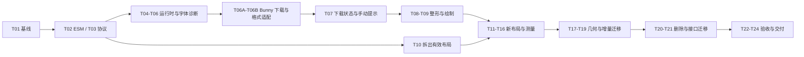

# HarfBuzz-only 迁移：24 个主任务与 2 个字体下载子任务

## 已确定的决策

基于 `fd11752e` 的代码评估，配套架构说明见 [移除方案](./legacy-removal-plan.md)。
各任务状态以实现记录为准，未标记完成的项目仍待实施。
2026-10-22：T01–T24 的实现与验收已完成，当前 Node24/浏览器、发行、资源与删除审计
见 [T23/T24 最终验收](./native-release-acceptance.md)。性能有明确成本与适用边界，
不宣称增量开关一定更快；DEFER-010 的性能优化与 SVG 实现继续保留。
协议说明见 [T03 布局协议](./layout-protocol.md)，基线见 [迁移记录](./legacy-removal-baseline.md)。

1. **缺字允许继续编辑**：所有已加载字体都不能覆盖某些文字时，按下载开关选择自动补字体
   或页面/控制台提示；保留原文和占位，补字体后复核。
2. **Bunny Fonts 自动补字体本期实现**：新增 `autoDownloadFonts`，默认 `true`。
   开启后按文字类别从 Bunny Fonts 下载基本字体；关闭时只提示手动补充字体包。
   DEFER-026 已作为本轮必做项完成实现和下载验收，2026-10-22 关闭。
3. **有效布局逻辑拆出保留**：先拆出旧循环里的表格、对象、段落和流布局职责，
   然后替换调用并删除旧调度与文字算法，不用删功能的方式完成迁移。
4. **只发布 ESM**：取消 UMD，不做 UMD/WASM 兼容封装，不提供 CommonJS 发行入口。
5. **严格单一文字排版源**：所有正常文字均由 HarfBuzz 整形并提供布局度量；
   缺字占位是显式异常对象，不会进入浏览器文字整形或旧引擎。

正常 DOM 工具栏、输入代理、表格边框、图片与数学公式自身的渲染不属于旧文字引擎。
`bidi-js`、逻辑/视觉光标语义也继续保留。

## 执行规则

- 推荐按 T01 → T24 顺序执行，每项形成一个可审查提交；任务较大时内部再按职责拆提交。
- T06 后插入 T06A、T06B，再执行 T07；既有任务编号保持稳定，共 26 项可执行工作。
- 每个提交只处理本项及其必需测试，不能用“后面会补”掩盖功能丢失。
- 中间步骤允许旧路径作为迁移对照；T20 之后生产包不允许再有旧引擎。
- 新布局先实现为独立入口；现有消费方需要时可在宿主边界临时转换，
  T17 接入原生几何、T19 删除该转换，禁止把旧文字算法混入新引擎。
- 所有新模块名与新增 API 均为设计目标，不是对现有代码的描述。
- 一项完成后记录提交、执行命令、验收结果和遗留问题，再进入依赖它的任务。
- 字体缺字是可恢复状态；WASM 或必要基础资源初始化失败才进入失败状态。

## 一、缺字处理的固定契约

### 检测规则

按以下顺序选择字体：显式字体与字重/样式 → 文种首选字体 → 其他已加载且允许用于备用的字体。
只要存在可正确整形的候选字体，就使用它；不能因为首选字体缺字而误报“所有字体缺失”。

覆盖检查必须同时参考字体字符映射和 HB 实际整形结果：

- 使用 Unicode 标量值，不能将代理对拆成两个缺字。
- 以 grapheme/cluster 及整形上下文检查组合符、emoji/ZWJ 和 variation selector。
- 不能把空格、换行、BiDi 隔离符、默认不可见字符“无轮廓”误判为缺字。
- “缺字体文件”“文件加载/解析失败”“缺字符/序列”“不支持字形绘制格式”分开报告。
- Script 只表示文字类别，不能由 Han 字符推断内容一定是中文或某一种语言。
  当前 `scriptFont.ts` 的区间正则需要覆盖补充平面和未知类别，不能作为完整覆盖检查。

### 诊断数据与接口

建议新增以下语义结构，字段名可在 T03/T06 中最终定型，但不能丢失其含义：

| 信息                                | 用途                                                                      |
| ----------------------------------- | ------------------------------------------------------------------------- |
| documentRevision、fontRevision      | 防止旧扫描结果覆盖新文档或新字体的状态                                    |
| reason                              | 缺字、缺序列、字体加载失败、字形格式不支持等可区分原因                    |
| script、categoryLabel               | 稳定文种标识与“汉字/CJK、阿拉伯字母、emoji、未知文字”等提示               |
| missingCharacters、missingSequences | 去重后的字符与完整序列，供后续字体查询或子集请求使用                      |
| codePoints                          | Unicode 标量码点列表，例如 `U+20000`，不保存成代理对码点                  |
| uniqueCount、occurrenceCount        | 不重复的缺字数量与出现次数分别统计                                        |
| samples                             | 有上限的示例，页面/日志默认最多展示 16 个 grapheme                        |
| locations                           | 带 scope、稳定节点 ID 和范围的来源信息，可定位正文/单元格/页眉页脚        |
| requestedFamily、attemptedFaces     | 说明请求字体及实际检查过的字体                                            |
| downloadStatus、attemptedDownloads  | 说明自动下载开关、加载/失败/不支持状态和已尝试的 Bunny 字体，避免无限重试 |

新增 `fontCoverageChange` 事件与 `getFontCoverageReport` 查询入口。
事件携带可比较的当前快照，不仅是一次性的控制台字符串；宿主晚订阅时也能查询状态。
补字体使用明确的公共注册入口，例如 `editor.register.fonts(faces): Promise<FontRegistrationResult[]>`。

### 下载开关与固定行为

以下是待实施的配置设计，不是当前已存在的 API：

```typescript
const editor = new Editor(container, data, {
  autoDownloadFonts: true // 默认值；false 时仅提示手动补充字体包
})
```

| 场景                               | 页面行为                                     | 控制台与网络行为                                                 |
| ---------------------------------- | -------------------------------------------- | ---------------------------------------------------------------- |
| 开关未配置或 true，现有字体已覆盖  | 正常显示                                     | 不发送额外字体请求                                               |
| true，首次发现缺字                 | 显示“正在补充某类文字的基础字体”，占位可编辑 | 合并缺字请求，从 Bunny Fonts 取字体；可恢复加载中状态不重复 warn |
| true，下载成功且重新检测通过       | 原文重新排版，撤销加载/缺字提示              | 更新 fontRevision；相同已缓存字体不重复下载                      |
| true，下载失败/无适用字体/仍有缺字 | 显示类别、样例、原因，提示手动补充字体包     | 去重 warn；本轮不无限尝试其他服务商或重复请求                    |
| false，发现缺字                    | 立即提示手动补充字体包                       | 去重 warn；禁止自动 Bunny CSS/字体请求和预连接                   |

`false` 不禁止宿主显式配置的 `fonts.url` 或手动字体注册。
切换为 false 后停止排队请求、取消本实例请求订阅，不移除已注册字体；
共享请求仍被其他实例需要时继续，最后一个订阅取消时才中止。
切换回 true 后只处理当前仍缺失的文字。缓存命中可直接注册，不需要新的网络请求。

### 页面、控制台和占位行为

- 页面默认提供编辑器实例内的非阻塞状态区域，例如：
  “缺少可显示汉字/CJK 的字体：8 个不同字符。示例：𠀀、汉。请补充覆盖这些字符的字体。”
- 状态区域支持展开查看分类和码点，使用现有 i18n 和 UI 方向规则，具有可访问的状态语义。
- 状态区域不改变画布坐标原点，不进入文档模型、历史、分页、图片导出或打印。
- 自动下载关闭、下载失败或下载后仍缺字时，控制台按新增/变化的缺失集合去重 `console.warn`；
  重复重绘或重复输入同一缺字不刷屏。
  完整字符列表保留在诊断接口，日志不打印整篇内容或完整来源片段。
- 不重复弹 alert；多个编辑器各自维护提示，destroy 时清理 DOM 和订阅。
- 文档删除相关文字、替换内容、补字体、字体加载失败或设计态变化后重新计算当前快照。
- 有缺字时 ready 正常完成，保存/复制保留原文；占位有稳定几何与索引，仍可定位和删除。
- 优先使用基础字体的 `.notdef` 字形及其度量；不可绘制时使用明确的 `MissingGlyphBox`。
  此盒不冒充真实字宽，不调用 `measureText`/`fillText`，也不替换持久化文字。
- 下载与排版异步完成，不能覆盖过期文档 revision，不能在 destroy 后更新页面或重新挂载。

### Bunny Fonts 字体选择与传输协议

使用 Bunny Fonts 的字体目录与 CSS 接口 `https://fonts.bunny.net/css`。
“对应语言”在实现中拆成 Script/实际码点覆盖与必要的地区字形提示，不能只按 UI 语言选字体。
优先使用用户已配置的字体；自动下载的基本字体只补未覆盖内容，不覆盖全文 font 样式。

首版候选映射如下，真正覆盖能力以下载字体的 cmap 与 HB 整形复核为准：

| 文字类别                  | 首选基本字体候选                                       |
| ------------------------- | ------------------------------------------------------ |
| Latin/Greek/Cyrillic      | Noto Sans                                              |
| 汉字/CJK，缺少语言提示    | Noto Sans SC；如文档明确繁体或日文，选择相应地区字体   |
| 繁体中文字形              | Noto Sans TC                                           |
| 日文                      | Noto Sans JP                                           |
| 阿拉伯文字                | Noto Naskh Arabic                                      |
| 天城文                    | Noto Sans Devanagari                                   |
| 泰文                      | Noto Sans Thai                                         |
| 其他类别、emoji、未知序列 | 从经过验证的映射表选择；没有适用条目时提示手动补字体包 |

基本字体默认使用 400 normal。目标样式存在已验证可用的字重/斜体时按需追加，
不能把样式缺失误报成字符缺失，也不能宣称 regular 等同于真实 bold/italic。
基础字形或样式均无法满足时按诊断类型提示，不回退浏览器整形。

下载管线必须完成：

1. 以字体家族、文种/地区、字重/样式查询 CSS 元数据；不猜测未验证的字体文件地址。
2. 解析 `@font-face` 的 URL、格式、样式和 `unicode-range`；按本地所需 cluster 与上下文
   选择字体片段，不能只下载 CJK 的 Latin 片段，也不能默认拉取全部大型字体片段。
3. 下载字体二进制 ArrayBuffer，归一化成 HB 与字形后端可读取的数据，然后注册。
   插入 `<link>` 或 CSS `@import` 本身不满足 HarfBuzz 字体注册需求。
4. T06A 必须验证 TTF/OTF/WOFF/WOFF2 格式；当前安装的 `opentype.js` 遇到 WOFF2
   会要求外部解压器，因此要接入经过测试的解压/格式适配，不能等下载成功后再失败。
5. FontManager 的缓存标识要包含字体片段或内容标识，不能仅按 family/weight/style
   去重，否则同一 CJK 家族的不同 unicode-range 片段会覆盖或被忽略。
6. 合并相同请求，限制并发，设置超时和有限重试；失败有负缓存和手动重试入口。
7. 内存及持久缓存按提供方、家族、样式、片段和资源版本隔离，带淘汰与再验证策略；
   Bunny 字体会更新，不能只用 family 名称永久复用旧资源。
8. 字体注册后重新检查实际缺字范围，更新字体版本并使相关布局 scope 失效。
   下载成功不等于全部缺字已解决，不启动无限下载循环。

按基本字体/片段下载，不依赖服务端按文字子集生成能力；文档原文和缺字样例不拼进请求 URL。
T06A/T06B 验收时实测 CSS/字体跨域读取、重定向、Content-Type、字体格式和资源更新行为。
本轮方案调研确认目录/API 描述，未把端到端二进制下载与解码标记为已验证。

来源核对：Bunny 官方 [API 说明](https://fonts.bunny.net/about/)、
[字体更新说明](https://fonts.bunny.net/faq)、[Noto Sans SC](https://fonts.bunny.net/family/noto-sans-sc)、
[Noto Sans](https://fonts.bunny.net/family/noto-sans)、
[Noto Naskh Arabic](https://fonts.bunny.net/family/noto-naskh-arabic)、
[Noto Sans Devanagari](https://fonts.bunny.net/family/noto-sans-devanagari)、
[Noto Sans Thai](https://fonts.bunny.net/family/noto-sans-thai)、
[Noto Sans TC](https://fonts.bunny.net/family/noto-sans-tc)、
[Noto Sans JP](https://fonts.bunny.net/family/noto-sans-jp)。
接口是字体 CSS API，不假设存在“输入语言即自动返回正确基本字体”的接口。

## 二、按顺序执行的子任务

### T01 — 冻结迁移基线与功能样本

- **前置**：无。
- **落点**：`tests/factories`、`tests/core`、`cypress`、迁移记录。
- **工作**：记录现有接口/元素/容器清单；固定文字、字体、DPR、视口和代表文档；
  建立纯文本、控件病历、嵌套表格、环绕分栏、混合纸张方向、打印等样本。
- **交付**：基线样本、当前通过/失败项和分阶段回归清单。
- **验收**：能区分已有问题与迁移回归；测试期望不是简单把新结果全部更新成快照。

### T02 — 将库构建和发行入口改为 ESM-only

- **前置**：T01。
- **落点**：`vite.config.ts`、`package.json`、README、构建/消费端测试。
- **工作**：设置 `build.lib.formats: ['es']`；删除 UMD `main`；规范 `module`、
  `types` 与仅支持 ESM import 的 `exports`；盘点文档化子路径，不无意切断已有导入。
- **交付**：ESM 入口/类型/声明过的子路径映射，无 require 或 UMD 入口。
- **验收**：清理旧 dist 后可构建；tarball 不含历史 UMD/CJS 产物；打包器和浏览器 ESM
  消费样例能加载相对路径的 worker/WASM/字体资源。已知 UMD 失败不再属于目标构建。

### T03 — 定义统一布局与字体诊断协议

- **状态**：已实现（2026-10-16）。
- **实现记录**：[布局协议](./layout-protocol.md)；本项不接入后续字体/运行时功能。
- **验证**：12 项针对性单测、TypeScript 和相关 ESLint 通过；全量回归留到后续改造完成。

- **前置**：T01。
- **落点**：`interface/Row.ts`、`interface/Draw.ts`、`text-engine/types.ts`、新布局接口。
- **工作**：定义 TextLine、InlineObject、BlockBox、TableFragment、BreakNode、
  MissingGlyphBox，以及逻辑索引/cluster/caret 的映射规则。
- **交付**：内容高度、段距、基线、容器坐标、字体引用、scope 与 revision 的单一约定。
- **验收**：对象和文字用判别类型区分；空段、隐藏内容、段后间距、跨页片段可准确表达；
  不再用“engineLine 缺失”暗示需要旧引擎。

### T04 — 建立统一 HarfBuzzRuntime 与 ready 生命周期

- **状态**：已实现（2026-10-16）。
- **实现记录**：[ready 生命周期](./editor-ready.md)。
- **验证**：21 项针对性测试、TypeScript、相关 ESLint、ESM 库构建及 tarball 静态消费通过。
  全量单测与真实浏览器回归按要求留到后续改造完成后统一执行。

- **前置**：T02、T03。
- **落点**：`editor/index.ts`、`Draw.ts`、`LayoutHostAdapter.ts`、新 Runtime 模块。
- **工作**：集中 WASM 初始化；公开 `editor.ready` 和异步创建入口；定义未就绪命令行为。
- **交付**：initializing/ready/failed/destroyed 状态与错误契约，删除首屏先用旧引擎的设计依赖。
- **验收**：慢初始化、并发创建、失败、destroy 后回调都有测试；缺字不等于初始化失败；
  同步测高等命令在 ready 后仍保持明确的同步返回值。

### T05 — 实现字体注册、覆盖与备用字体解析

- **状态**：已实现（2026-10-16），全量回归按要求暂缓。
- **实现记录**：[字体解析与注册](./font-resolver.md)。
- **验证**：52 项针对性检查、TypeScript、相关 ESLint、ESM 库构建和 tarball 静态消费通过。
  包含真实基础字体、标量/组合序列、同家族片段、备用选择、版本失效与公开注册重排。
- **边界**：WOFF/WOFF2 格式归一化仍按 T06A；缺字聚合/页面提示按 T06/T07。

- **前置**：T03、T04。
- **落点**：`FontManager.ts`、`scriptFont.ts`、`interface/TextEngine.ts`、字体 manifest。
- **工作**：建立 face ID、样式匹配、覆盖缓存和 fontRevision；明确最小基础字体与占位能力。
- **交付**：可注册新字体的 FontResolver，不要求预装所有文字字体。
- **验收**：首选字体缺字但其他加载字体能显示时正确选用备用字体；补充平面、组合序列、
  字体失败和字重缺失可区分；不能依赖 CSS 系统字体隐式补字。

### T06 — 实现缺字集合与恢复机制

- **状态**：已实现（2026-10-16），全量回归按要求暂缓。
- **实现记录**：[缺字快照与恢复](./font-coverage.md)。
- **验证**：10 个测试文件、86 项针对性检查，TypeScript、相关 ESLint、ESM 库构建和发行包静态消费通过。
- **边界**：Bunny 元数据/解码、下载开关/调度、页面提示分别留在 T06A、T06B、T07。

- **前置**：T03、T05。
- **落点**：新 FontCoverageTracker、`EventBus.ts`、`Listener.ts`、字体注册入口。
- **工作**：按前述契约聚合字符/序列/类别/数量/位置；检查 HB 缺字结果；生成占位节点；
  提供 `fontCoverageChange` 与查询接口。
- **交付**：当前文档缺字快照与补字体后的重新解析、缓存失效和重排能力。
- **验收**：已解决项会清除；旧 revision 结果不能复活；重复扫描无重复事件风暴；
  原文和光标索引完整保留；隔离符与空白不误报。

### T06A — 建立 Bunny Fonts 映射、元数据与字体格式适配

- **状态**：已实现（2026-10-16）；全量回归仍暂缓。
- **实现记录**：[Bunny 字体提供方](./bunny-font-provider.md)。
- **验证**：84 项针对性检查；五类真实字体 Node/浏览器端到端验证；中英同家族多片段和实际 WOFF/WOFF2 通过。
  TypeScript、相关 ESLint、ESM 构建、冻结锁文件与发行包静态消费检查通过。
- **边界**：Bunny 编号 CJK 片段缺少范围时只选命名基本子集，罕见字需实际覆盖复核；开关、调度与缓存仍按 T06B。

- **前置**：T05、T06。
- **落点**：新 BunnyFontProvider/字体映射表、字体二进制解码器、FontManager。
- **工作**：验证候选基本字体与文种/地区映射；解析 CSS 元数据与 unicode-range；
  下载并验证真实字体样本，补齐 WOFF2 等格式归一化和多片段注册标识。
- **交付**：可由诊断生成字体资源请求、并交付有效字体二进制的提供方适配器。
- **验收**：至少中英文、阿语、天城文、泰文样本可被 HB 和字形后端实际读取；
  CJK 片段不漏注册；不存在字体的类别有明确 unsupported 结果；不是只验证 CSS 标签能加载。

### T06B — 实现默认开启的下载开关、调度与缓存

- **状态**：已实现（2026-10-17）；全量回归仍暂缓。
- **实现记录**：[自动补字体与缓存](./font-download.md)。
- **验证**：105 项针对性单测、2 项浏览器生命周期检查与 2 项真实 Bunny 联网检查通过。
  包含首选 regular 缺少 bold 时实际补齐 700 字重；TypeScript、相关 ESLint、ESM 构建和发行包消费检查通过。
- **边界**：当前在 HarfBuzz 模式接入；默认页面提示/控制台去重仍按 T07；跨标签冷启动不做分布式锁。

- **前置**：T04、T06、T06A。
- **落点**：IEditorOption、mergeOption、新 FontDownloadManager、字体注册与生命周期。
- **工作**：新增 `autoDownloadFonts` 默认 true；缺字时调度 Bunny 请求，合并/缓存/限流；
  处理失败、重试、运行期切换、共享请求取消、字体补齐与布局失效。
- **交付**：本期可运行的自动补字体闭环，状态含 disabled/loading/resolved/failed/unsupported。
- **验收**：未配置即开启；false 时没有自动 Bunny 请求；重复输入/多实例不重复下载；
  离线/超时/404/格式失败转手动提示；旧响应不污染新文档，destroy 后无 UI 副作用。

### T07 — 实现自动下载状态及手动补字体提示

- **状态**：已实现（2026-10-17）；全量回归仍暂缓。
- **实现记录**：[内建状态与去重告警](./font-download.md)。
- **验证**：35 项字体诊断/下载/覆盖/ready 定向单测及 4 项浏览器检查通过，
  包含坐标不变、打印隔离、运行期语言/RTL、多实例销毁与失败告警去重。
  TypeScript、相关 ESLint、ESM 构建及发行包消费检查通过。

- **前置**：T06、T06B。
- **落点**：新字体诊断 UI、`assets/css`、i18n、Editor/Draw 生命周期。
- **工作**：内建非阻塞提示区域，显示加载中、已解决、下载失败或手动补字体状态；
  按类别展示有限样例、数量和码点；失败/关闭下载时输出去重日志。
- **交付**：无需宿主额外订阅即可看到的默认页面提示，以及事件供自定义 UI 使用。
- **验收**：同时满足“页面提示”和“console.warn”；补字体/删文字后更新；多实例隔离；
  不改变坐标，不进入打印、导出和历史；关闭时没有自动请求，开启成功时清除缺字告警。

### T08 — 全部文字统一走 HarfBuzz 整形

- **状态**：已实现（2026-10-17）；全量回归仍暂缓。
- **实现记录**：[统一 HarfBuzz 整形](./harfbuzz-shaping.md)。
- **验证**：105 项定向单测、5 项浏览器检查通过；真实字体对比 HB glyphId/advance/offset，
  覆盖多文种、跨颜色连字、组合附加符、对象与缺字占位的增量索引。
- **边界**：HarfBuzz 整形不再调用浏览器 shaper/测宽；绘制路径按 T09、旧引擎删除按 T20。

- **前置**：T05、T06。
- **落点**：`HarfBuzzTextShaper.ts`、`TextLayoutEngine.ts`、`ElementBridge.ts`。
- **工作**：取消 Latin/CJK 的 BrowserTextShaper 绕行；去掉浏览器 advance 校准；
  缺字进入诊断/占位；行内对象提供独立 advance，不借用 BrowserTextShaper。
- **交付**：所有正常文字使用 HB glyphId/advance/offset 的单一整形接口。
- **验收**：中英文、阿语、印地、泰文、组合符、跨颜色连字使用真实字体测试；
  没有字体覆盖的输入明确报告，不进入浏览器 shaper。

### T09 — 绘制直接消费 HarfBuzz 字形

- **状态**：已实现（2026-10-17）；全量回归仍暂缓。
- **实现记录**：[HarfBuzz 字形绘制](./harfbuzz-glyph-rendering.md)。
- **验证**：87 项定向单测、6 项浏览器检查通过；包含五种文种真实字体墨迹对比、
  CFF 曲线、跨色连字/上下标、缓存淘汰、unsupported 格式和完整/增量差分。
- **边界**：单色轮廓后端；颜色字形明确诊断，旧对象循环/原生选区及旧引擎删除按后续任务。

- **前置**：T03、T08。
- **落点**：`GlyphRenderer.ts`、字体轮廓/字形缓存与必要后端。
- **工作**：替换视觉分段 fillText；按字体引用和 glyphId 绘制，统一色彩、上下标与基线。
- **交付**：字形路径或基于同一字体字形的后端；明确多色连字和颜色字形支持策略。
- **验收**：布局宽度和实际墨迹一致；新 GlyphRenderer 正文路径不调用 fillText/measureText；
  不支持的字形格式有独立诊断，不错误提示“请补字体”来掩盖后端不支持。

### T10 — 拆出旧循环中的有效布局逻辑

- **状态**：已实现（2026-10-17）；全量回归仍暂缓。
- **实现记录**：[布局职责提取](./layout-geometry.md)。
- **验证**：99 项定向单测、8 项浏览器检查通过，含 T01 六组样本的 12 项拆分前后几何对比。
- **边界**：显式几何模块已独立；旧入口暂时委托调用，原生表格/对象与分页接入按 T12/T13/T15。

- **前置**：T01、T03。按线性顺序可在 T09 后执行，也可提前单独完成。
- **落点**：`Draw.computeRowList` 的 TABLE/IMAGE/LATEX/BLOCK/AREA 等分支。
- **工作**：按职责提取 TableGeometry、InlineObjectMeasure、BlockMeasure、
  ParagraphStyleResolver 和 FlowConstraints；旧入口暂时调用提取结果保持行为。
- **交付**：不依赖旧文字循环局部变量的模块，显式接受容器、样式、尺寸与子布局回调。
- **验收**：用 T01 样本证明提取前后行为一致；没有复制整段旧循环后仅改名字；
  表格分支的合并格高度、图片适配等真实功能均有独立覆盖。

### T11 — 统一段落入口与原生 TextLine（已完成）

- **前置**：T03、T08、T09、T10。
- **落点**：`LayoutHostAdapter.ts`、`TextLayoutEngine.ts`、原生布局结果构建器。
- **工作**：直接生成原生文字行；统一 rowMargin、段距、字体行盒、对齐、tab、字距、
  显式宽度、隐藏折叠和空段；核对最终行边界整形。
- **交付**：不经 mapToLegacyRow 的原生段落布局入口，及 TextLayoutService 的基础测量接口。
  现有消费方的临时适配留在宿主边界，按 T17/T19 迁出。
- **验收**：长段、窄行、RTL/BiDi、kashida、标点、空段及段距装饰通过；
  不通过“无行结果返回旧循环”来处理空内容。

- **实现**：`TextLayoutService.layoutParagraph` 直接构建 `TextLine`；宿主
  `layoutParagraph` 返回原生结果，`layoutParagraphToRows` 仅调用宿主边界的
  `projectNativeRows`。生产段落入口不再引用 `mapToLegacyRow`。
- **度量**：`measureText` 提供未约束宽度、真实字体行盒高度及 ascent/descent；
  实际 face 的 HB extents、轮廓、上下标偏移与 rowMargin 决定行盒。
  tab、字距、显式元素宽度、空段、隐藏折叠与段距走同一入口。
- **整形**：最终行边界重新整形，溢出时只细分源区间；保留换行空白，
  kashida 插入使用原始 UTF-16 映射，组合 cluster 内不插入对齐间隙。
- **验证**：见 [T11 段落布局](./native-paragraph-layout.md)。按要求暂不执行全量回归。
- **边界**：表格/块外壳的 forceLegacy、控件和 label 后处理、旧交互 DTO
  仍按 T12–T20 迁出；本项不宣称已删除整个 legacy 引擎。

### T12 — 表格与嵌套表格接入新布局（已完成）

- **前置**：T10、T11。
- **落点**：提取后的 TableLayout、TableParticle、TablePaging、TableOperate。
- **工作**：统一容器宽度、td 内边距、递归子布局、rowspan/colspan 高度和垂直对齐；
  自动列宽改为整形文本的内在宽度测量。
- **交付**：表格几何不依赖旧文字循环，表内文字全部走 HB。
- **验收**：嵌套、空行、合并格、RTL 镜像、边框颜色宽度、列宽拖动通过；
  单元格段前/段后间距正确计入尺寸，父容器宽度不错误取成全局正文宽度。

- **实现**：新增纯数据 `TableLayout` 和宿主 `TableLayoutHost`，原生 TABLE 分支
  不再调用 forceLegacy；递归输出独立 cell scope 下的 TextLine/TableFragment。
- **测量与操作**：自动列宽使用 HB 段落内在宽度，包含跨列约束与嵌套内容；
  自动适应和拖列使用实际父容器；修复 RTL 逻辑列末端和拖动方向。
- **尺寸**：统一段前/段后流高度、合并格最终高度、单元格垂直偏移和拆分窗口；
  同步嵌套表格子位置，保留边框颜色/宽度与现有分页消费接口。
- **说明**：见 [T12 原生表格布局](./native-table-layout.md)。原生分页/绘制和 DTO
  消费方按 T15/T17/T19 继续迁移，显式 legacy 模式按 T20 删除；暂不执行全量回归。

### T13 — 对象、Block 与 Area 接入新布局（已完成）

- **前置**：T10、T11。
- **落点**：对象布局器、Image/LaTex/Block/Area、分页符与分隔线节点。
- **工作**：迁移图片/公式超宽适配、基线、题注空间；Block/Area 生成明确对象盒。
- **交付**：对象提供尺寸与逻辑锚点，不生成伪文字行、不调用 forceLegacy。
- **验收**：图文同行、对象选中/拖拽、隐藏与显示、Block 打印、空段前后插入正确；
  数学公式自身的渲染能力保留。

- **实现**：对象布局直接生成 BlockBox/BreakNode 和逻辑锚点；删除原生路径中
  剩余 forceLegacy 插行与特殊伪文字行入口，旧消费者只在宿主边界获取 IRow。
- **图片/公式**：按实际容器等比适配、以 HB 行基线底对齐；题注使用同一真实字体
  行盒预留与绘制，保留 LaTeX SVG 转换和浮动公式绘制。
- **Area/Block**：区域按归一化来源重建原生盒，顶部偏移只应用一次，保留表内独立区域；
  Block 缩放使用实际尺寸和父宽，隐藏清理嵌套 DOM，保留打印截图入口。
- **验证**：见 [T13 原生对象布局](./native-object-layout.md)。全量回归继续暂缓。

### T14 — 控件、列表与文字装饰接入新布局（已完成）

- **前置**：T11、T13。
- **落点**：Control、ListParticle、Label/Date/Hyperlink、装饰层与 normalizer。
- **工作**：控件 chrome 文字走 HB；补白改为布局对象；迁移列表编号、层级、缩进、续号；
  保留 minWidth、flex、VALUE_START、嵌套、背景/边框与只读规则。
- **交付**：控件/列表不依赖旧文字粒子，不向持久化数据插入排版专用补白节点。
- **实现**：`ControlLayout` 在换行前生成临时 `controlSpace`，支持最小宽度、对齐及
  VALUE_START 续行约束；标签 padding/背景盒和列表标记进入原生几何。
  列表测量、绘制使用 HB；导入/导出清理旧补白节点；移除三处引擎排版后修正。
  原生空行、删除线及留痕装饰不再调用旧文字测量；缺字提示按稳定源标识定位值、
  占位文字及表格单元格。
- **验收**：空值、清空/赋值、换行、控制值覆盖、复选框标签切换、只读与打印；
  页面提示能定位控件值或占位文字的缺字。
- **验证**：见 [T14 原生控件、列表与装饰](./native-chrome-layout.md)。全量回归继续暂缓。

### T15 — 分页、分栏、环绕与容器接线（已完成）

- **前置**：T12、T13、T14。
- **落点**：文档流布局、ColumnManager、TablePaging、Header/Footer、浮动对象管理。
- **工作**：按页和栏传入真实可用宽度；环绕传入行可用区间并重新断行，
  不再仅平移已排好的行；统一拆表窗口、重复表头与 maxPageNo 截断。
- **交付**：正文、td、页眉页脚各有明确 scope 与文档流约束。
- **实现**：`DocumentFlow` 维护实际页、栏与纵向位置；原生段落按逐行区间重新断行，
  删除 `_applyEngineRowGeometry` 的排版后平移。拆表消费同一游标，行落位供最终分页
  和 Position 直接使用；原生片段保存裁剪窗口及重复表头。页眉页脚按纸张方向隔离缓存，
  表格单元格保留局部 scope，活动框架的兼容位置数据按方向恢复。
- **验收**：横竖混排、跨页表格、重复表头、多浮动对象和分栏不重叠、不丢字；
  scope 间缓存/缺字定位不串用。
- **验证**：见 [T15 原生文档流](./native-document-flow.md)。全量回归继续暂缓。

### T16 — 辅助文字与测量 API 全量迁移（已完成）

- **前置**：T11、T12、T14、T15。
- **落点**：drawPlainText、LineNumber/PageNumber/Watermark/Placeholder/Ruler、
  Image/PageBreak/Trace/List、`computeElementListHeight`。
- **工作**：辅助文字和业务测量统一使用 T11 建立的 TextLayoutService，补齐单行等入口；
  文本省略按 grapheme/cluster 截断；缺字也进入同一诊断。
- **交付**：所有辅助文字使用 HB，所有业务测高/测宽取消旧文字粒子依赖。
- **验收**：题注、水印平铺、页码、标尺、测高、表格自动列宽通过；
  旋转/缩放/混合纸张方向无异常；ready 前调用有明确行为。
- **实现与验证**：见 [T16 辅助文字与测量](./native-auxiliary-layout.md)。全量回归继续暂缓。

### T17 — 坐标、命中、光标与选区统一（已完成）

- **前置**：T11–T16。
- **落点**：Position、Cursor、HitTestAdapter、Range、Search、Spellcheck、Group。
- **工作**：统一消费布局树、cluster 与 caret stops；移除旧累加 x 和双路径对齐；
  保留逻辑/视觉移动、对象和控件边界语义。
- **交付**：一份文字几何同时供绘制、命中、搜索、批注、拼写波浪线与选区使用。
- **验收**：点击、拖选、Shift 锚点、IME、删除、移动端 beforeinput、跨表格选区通过；
  段后间距不进入选区；旧 `IElementPosition` 若对外仍有需要，仅作为输出 DTO。
- **实现与验证**：见 [T17 原生交互几何](./native-interaction-geometry.md)。全量回归继续暂缓。

### T18 — 提取脏区间并迁移 HarfBuzz 增量（已完成）

- **前置**：T15、T17。
- **落点**：IncrementalRowComputer、IncrementalParagraphComputer、模型修改入口。
- **工作**：提取 DirtyRangeTracker；新增量缓存原生布局节点并纳入 fontRevision；
  保留 full-dirty、scope 追踪和字体补充后的失效。
- **交付**：旧行快照算法无调用者，完整/增量均使用同一 HB 排版源。
- **验收**：完整 HB vs 增量 HB 的随机编辑、拆合段、历史、补字体、跨页差分通过；
  不满足增量条件时只回退完整 HB，不回退旧引擎。
- **实现与验证**：见 [T18 原生增量布局](./native-incremental-layout.md)。全量回归继续暂缓。

### T19 — 删除旧行模型桥接与瞬态字段依赖（已完成）

- **前置**：T17、T18。
- **落点**：mapToLegacyRow、IRow/IRowElement、interface/Draw、序列化/历史工具。
- **工作**：移除新路径对旧投影的依赖；新路径禁止向文档元素回写仅用于排版的 metrics/visualLeft；
  需要保留的公共返回结构在输出边界生成。
- **编译边界**：仍被待删旧代码引用的隔离类型暂留至 T20 同步删除，
  不在此步先删类型导致旧实现无法编译，也不允许新路径重新依赖这些类型。
- **交付**：文档模型与布局模型分离，scope/节点 ID/索引映射完整。
- **验收**：保存、复制、HTML 往返、历史、表格 ID、组坐标 API 不丢语义；
  import 图和调用图不再依赖旧行投影。
- **实现与验证**：见 [T19 文档模型与布局分离](./native-model-separation.md)。全量回归继续暂缓。

### T20 — 删除旧引擎及全部模式开关（已完成）

- **前置**：T08–T19 完成。
- **落点**：Draw 旧循环、BrowserTextShaper、TextParticle、IncrementalRowComputer、
  forceLegacy/resume/快照类型、TextEngineMode、RenderMode、旧文字 Particle 分支。
- **工作**：删除无调用者实现、访问器、状态、常量和模式配置；清理旧 RTL 告警与字段清理回退。
- **交付**：生产代码只剩统一 HB 文本路径和专用对象布局。
- **验收**：没有通过改名或复制保留旧循环；没有 BrowserTextShaper 或浏览器文字测绘回退；
  logical/visual 编辑语义、正常对象绘制没有被误删。
- **实现与验证**：见 [T20 只保留 HarfBuzz 排版](./native-only-engine.md)。
  已删除旧主循环、旧分页回退、浏览器文字测绘和模式切换；
  定向单测与 Electron 回归、类型检查、ESLint、库构建和包消费检查通过。
  T21–T24 继续执行，未提前运行或宣称全量回归通过。

### T21 — 公共 API、示例与文档迁移（已完成）

- **前置**：T02、T04、T07、T20。
- **落点**：index 导出、options、register/command、mock、README、中英文文档。
- **工作**：公开 ready、字体注册与诊断接口；移除失效选项；写明旧配置与 ESM 消费迁移。
- **交付**：可以独立照文档运行的 ESM 示例，演示默认自动下载、关闭开关、失败提示和手动补字体。
- **验收**：不要求选择引擎；`textEngine: 'legacy'` 等旧配置有明确迁移处理；
  描述基本字体和覆盖边界；只有 T06A/T06B 实现与测试完成后才将自动下载标为已支持。
- **实现与验证**：见 [T21 公共 API 迁移记录](./public-api-migration.md)。
  主 Demo 等待 ready；独立 ESM 字体示例已通过发行包类型与构建检查，
  45 项定向单测及 5 项 Electron 检查通过，中英文文档已迁移。
  T22 全量回归、T23/T24 继续保留，不提前标记完成。

### T22 — 全量功能与真实浏览器验收（已完成）

- **前置**：T20、T21。
- **落点**：测试工厂、单测、Cypress、视觉样本与运行时守卫。
- **工作**：集成测试等待 ready 并使用真实字体；迁移旧测试的行为覆盖；
  在浏览器验证文字绘制、编辑、打印和缺字状态区域。
- **交付**：完整功能矩阵及文字管线禁止 fillText/measureText 的调用守卫。
- **验收**：中文/Latin/RTL/复杂脚本/emoji 与对象组合覆盖；自动下载默认开启及 false 零请求通过；
  模拟下载成功/失败、缓存、多片段、开关切换，并有 Bunny 真实网络单独烟测；
  稳定单测不依赖实时公网可用性；缺字从首屏到补字体恢复闭环；
  Chromium/Firefox 自动回归及可用环境中的 Safari/WebKit 验证有记录。
- **实现与验证**：见 [T22 原生管线完整功能矩阵与验收记录](./native-regression.md)。
  983 项单测、原有功能 149 项（含取消历史 skip 后的补跑）、Chromium 迁移 63 项、
  发行消费浏览器 16 项、Bunny 公网 2 项，以及 Firefox/WebKit 各 14 场景通过。
  T23 性能资源验收与 T24 最终审计仍保留；本机 Node 22 结果不代替 Node 24 CI。

### T23 — 性能、资源与 ESM 发行验收（已完成）

- **状态**：2026-10-22 完成；SVG 实现继续暂缓。
- **前置**：T18、T22。
- **落点**：基准样本、字体/字形缓存、发行打包及独立消费工程。
- **工作**：分别测冷启动、热编辑、整形、分页、绘制与内存；检查缺字扫描/日志去重成本；
  从发行 tarball 验证 ESM、类型、worker/WASM/字体路径与 WOFF2 解码资源。
- **交付**：与 T01 对比的性能报告和 ESM-only 发行检查结果。
- **验收**：无未解释的重大退化或持续缓存增长；离线配置可用；产物无 UMD/CJS；
  复杂文档全量 HB 与纯文本增量的性能边界如实记录。

- **执行结果**：[性能、资源与发行报告](./native-release-acceptance.md)。当前与 T01 同机各 66 次采样；
  缓存与销毁检查、18 项 tarball 浏览器消费通过。性能差距及增量不一定更快已明确披露。

### T24 — 最终删除审计与迁移交付（已完成）

- **状态**：2026-10-22 完成；DEFER-016、DEFER-026 按实际验收关闭。
- **前置**：T01–T23 完成。
- **落点**：生产 import 图、类型导出、发行内容、文档和 DEFER-016。
- **工作**：逐条审计 [最终退出条件](./legacy-removal-plan.md#12-最终删除清单与退出条件)，
  核实主文档和辅助文字均无法再进入旧路径；整理破坏性变更说明。
- **交付**：实际执行结果、剩余性能边界、发行迁移说明和完成提交列表。
- **验收**：功能、浏览器、类型、构建、消费与资源检查全部通过后，才关闭 DEFER-016。
  DEFER-026 仅在默认开启、关闭零请求、成功恢复和失败转手动提示均通过后关闭，
  不能因“预留接口”或“CSS 可加载”而关闭。

- **执行结果**：[九条退出条件与最终矩阵](./native-release-acceptance.md#t24九条退出条件审计)。
  333 个生产 TS 文件、1,628 条 import/export 边审计通过；Node24 单测 985、原功能 149、
  迁移/公网 65、发行浏览器 18、Firefox/WebKit 各 14 项通过；保留首轮异常与独立复跑记录。

## 三、依赖与阶段门槛



| 阶段门槛                 | 必须具备的能力                                                                     |
| ------------------------ | ---------------------------------------------------------------------------------- |
| G1：允许接入新文字路径   | 只发 ESM；Runtime/ready 可观察；默认自动从 Bunny 补基本字体，关闭/失败有双通道提示 |
| G2：允许切换完整文档入口 | 全脚本 HB 与字形绘制可用；表格/控件/对象/文档流职责已迁出旧循环                    |
| G3：允许物理删除旧实现   | Position/命中/光标/装饰/测量/增量/历史均不依赖旧行模型和旧粒子                     |
| G4：允许宣称彻底完成     | 真实浏览器和发布验收通过；没有隐式旧路径；Bunny 自动下载开关与失败闭环已验收       |

## 四、每项交付的最小检查

- 有语义代码变更时运行 ESLint、TypeScript 与相关单测。
- 影响共用布局/模型/交互时运行全量单测与相关 Cypress；按样本比较实际绘制。
- ESM、Runtime 或资源路径变更时运行库/应用构建和独立消费端测试。
- 删除项须同时提交引用审计，不能仅依赖“编译没报错”。
- 记录字体、视口、DPR 和样本文档；缺字测试必须刻意使用不覆盖目标文字的字体。
- 文档计划修改本身不需要重复运行代码测试；不能将规划写入当成实现验收通过。

本执行清单不承诺固定工期。每项完成后再记录实际耗时与剩余风险，
避免在字体后端、对象布局尚未验证前给出没有依据的总时长。
